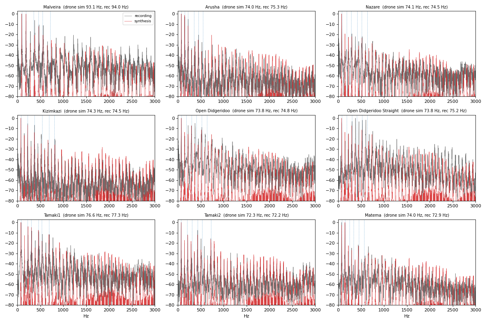

# Comparing the synthesizer with the Didge Archive

How realistic is a didgeridoo computed from its bore? The
[Didge Archive](https://github.com/Didgitaldoo/didge-archive) contains, for nine
didgeridoos, the measured bore and recordings of the real instrument: a neutral
drone, hand slaps on the mouthpiece (open and closed hand) and a song or a long
performance. This page describes how DidgeLab's simulation and synthesizer
(`didgelab.synth`) are compared with these recordings, what the comparison shows,
and how to repeat it.

The method and the full discussion are in [synthesizer.md](synthesizer.md), §7.
A runnable walk-through is the notebook
[examples/didge_archive_comparison.ipynb](examples/didge_archive_comparison.ipynb).

## 1. What is compared

| question | recording | simulation | measure |
|---|---|---|---|
| Is the drone at the right pitch? | neutral drone | first impedance peak | cents |
| Are the toots at the right pitch? | song (stable pitches above the drone) | higher impedance peaks | cents |
| Are the resonances right? | hand slaps | maxima (closed hand) / minima (open hand) of $\lvert Z_{in}\rvert$ | cents |
| Is the timbre of the drone right? | neutral drone | synthesized neutral drone | dB per harmonic and per third-octave band |

**Drone pitch.** The pitch of the neutral recording is tracked frame by frame
(`analysis.track_f0`) and its median is compared with the first DidgeLab
resonance:

```math
\Delta = 1200 \log_2 \frac{f_{\text{recorded}}}{f_{\text{simulated}}} \quad \text{cents.}
```

**Toots.** Stable pitches above the drone in the songs are clustered. A cluster
counts as a toot only if it is closer to a simulated resonance than to a harmonic
of the drone, and at least 50 cents away from that harmonic; otherwise a strong
harmonic or a formant could be mistaken for a toot.

**Hand slaps.** Slapping the mouthpiece makes the bore ring at its own
resonances. With the hand closing the mouthpiece the bore is closed at one end, and
the spectral peaks are the maxima of $\lvert Z_{in}\rvert$. With the hand lifted
away the bore is open at both ends, and the peaks are the minima. For the first
four maxima and minima of each instrument, the strongest spectral peak within
±150 cents is compared with the simulation.

**Harmonic fingerprint.** The levels $L_n$ (dB) of the first ten harmonics of the
drone depend strongly on the bore: a harmonic that falls on a resonance is
10–30 dB stronger than one between two resonances. For each recording $i$ the
measured levels relative to the fundamental, $\ell_n = L_n - L_1$, are compared
with the model levels $m^{(j)}_n = M^{(j)}_n - M^{(j)}_1$ of every instrument $j$
at the recorded pitch. A free offset $a$ and spectral tilt $b$ absorb the
recording chain:

```math
d_{ij} = \min_{a,b} \sqrt{\frac{1}{9}\sum_{n=2}^{10}
\left(\ell^{(i)}_n - m^{(j)}_n - a - b \log_2 n\right)^2 }.
```

If the model is realistic, recording $i$ is closest to model $i$.

**Spectral envelope.** One-third-octave band levels (63 Hz–5 kHz) of the
harmonics of the neutral recordings are compared with the synthesized neutral
drone; only a common gain is fitted. The global model parameters (lip open
quotient and skew, source impedance, neutral mouth shape, directivity tilt) were
fitted with leave-one-instrument-out cross-validation, so the error of each
instrument is measured with parameters that were not fitted on it.

## 2. Results

The numbers are produced by `scripts/synth/evaluate_archive.py` and stored in
[results/synth/archive_eval.json](results/synth/archive_eval.json).

| test | result |
|---|---|
| drone pitch, 9 recordings | mean absolute error **17.5 cents**, mean error +11 cents |
| toots, 2 clear cases (Tamaki1, Tamaki2) | played **27–40 cents below** the resonance |
| hand closed ↔ maxima of $\lvert Z_{in}\rvert$, n = 20 | median error 31 cents, 75 % within 50 cents |
| hand open ↔ minima of $\lvert Z_{in}\rvert$, n = 20 | median error 25 cents, 95 % within 50 cents |
| harmonic fingerprint | correct instrument for **7 of 9** recordings (chance 12.5 %), rms 5.2 dB |
| third-octave envelope, leave-one-out | rms error **4.9 dB** (default parameters 5.1 dB, generic 1/n spectrum 6.1 dB) |

What this means:

* DidgeLab predicts the **drone** within the precision with which a player holds
  it; the players hold it on average 11 cents above the first resonance. Only
  Matema is clearly flat (−27 cents).
* **Toots** are played consistently below the impedance peak, while the drone is
  not. The synthesizer therefore plays toots 34 cents below the resonance
  (`ModelParams.toot_cents`).
* The **resonances** seen in the hand slaps confirm the simulation. The slaps are
  short and noisy, so these errors are an upper bound.
* The **timbre** of the synthesized drone identifies the right instrument in
  seven of nine cases, and its spectral envelope is within about 5 dB of the
  recordings.

These numbers use the Levine–Schwinger radiation impedance at the bell (see
[transmission_line_model.md](simulation_methods/acoustical_simulation/transmission_line_model.md)).
With the earlier radiation impedance, whose end correction was too short, the
drone matched better on average (mean absolute error 15 cents) but the
open-hand slaps (42 cents) and the toots (40–50 cents below the resonance) much
worse.



*Spectra of the neutral recordings (grey) and of the synthesized neutral drones
(red); dotted: DidgeLab resonances.*

## 3. Archive index correction

The archive entry "Tamaki2" points to the Open Didgeridoo geometry, but the
archive also contains `tamaki2.json`. The simulated drone of `tamaki2.json`
matches the recording (−4 cents) while `opendidgeridoo.json` is 38 cents off, so
`didgelab.synth.archive` uses `tamaki2.json` (`archive.GEOMETRY_OVERRIDES`).

## 4. Repeating the comparison

```bash
git clone --depth 1 https://github.com/Didgitaldoo/didge-archive.git
export DIDGE_ARCHIVE=$PWD/didge-archive
python scripts/synth/evaluate_archive.py          # from the didge-lab root
```

Without `DIDGE_ARCHIVE`, `didgelab.synth.archive.locate()` looks in
`./didge-archive` and finally clones the archive to `~/.cache/didgelab/didge-archive`.
In Python:

```python
from didgelab.synth import archive, Bore

for inst in archive.load():                 # all instruments with geometry and recordings
    bore = Bore(inst.geometry)
    print(inst.name, round(bore.drone, 1), "Hz")
```

The script writes `doc/results/synth/archive_eval.json`, the figure
`doc/figures/archive_neutral_spectra.png`, and synthesized neutral drones to
`outputs/synth-audio/`.

## 5. Limits

* Nine instruments, one player per recording, one recording chain per
  instrument. The parameters of the model are fitted on the same data
  (leave-one-out for the envelope).
* The source impedance and the overall width of the vocal tract could not be
  identified from the neutral drones; they were fixed from the formants of the
  performances ([synthesizer.md](synthesizer.md), §7.5).
* Only two toots could be measured reliably.
