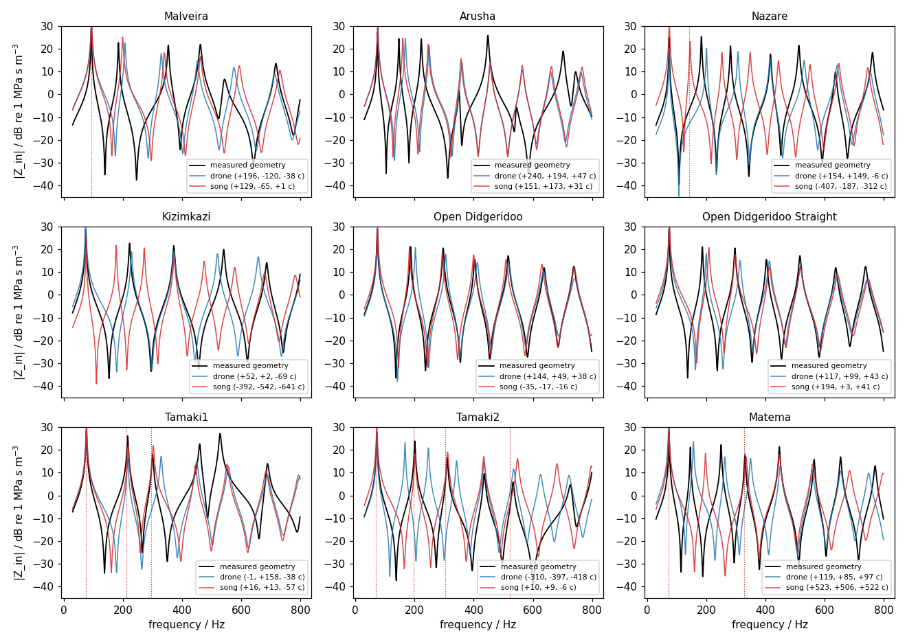
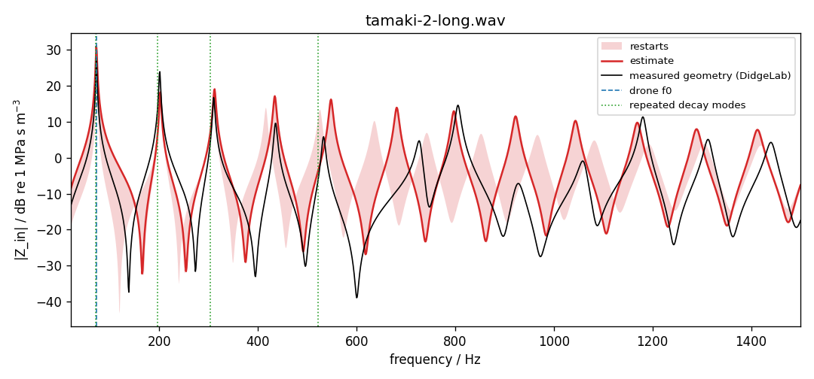

# Impedance spectrum from a sound sample

`didgelab.synth.estimate_impedance` estimates the input impedance
$Z_{\text{in}}(f)$ of a didgeridoo whose geometry is unknown, from nothing but
a recording of it being played. It is the inverse of the synthesizer in
`didgelab.synth`: instead of computing the sound from a bore, it fits a bore to
the sound and returns that bore's impedance spectrum.

The full derivation and evaluation are in the didge-synth article
[*Reading the bore from the sound*](https://github.com/jnehring/didge-synth/blob/main/docs/impedance.md).
This page summarises it for DidgeLab users.

## Usage

```python
import soundfile as sf
from didgelab.synth import estimate_impedance, render_song_loop_from_peaks

x, fs = sf.read("recording.wav")          # mono float array
if x.ndim > 1:
    x = x.mean(axis=1)
est = estimate_impedance(x, fs)           # 1-3 minutes

est.resonances      # [(freq_hz, |Z| in MPa s/m^3, Q), ...] of the fitted bore
est.freqs, est.zin  # complex Z_in on a 1 Hz grid up to 3 kHz (Pa s/m^3)
est.band_db         # min/max of 20 log10|Z_in| over the optimiser restarts
est.geometry        # one bore that explains the sound (not unique!)
est.obs             # drone pitch, harmonic levels and free-decay modes found in the sample

# hear the estimated instrument
y, fs = render_song_loop_from_peaks(est.peaks[:6], "tiki-du")
```

`didgelab.synth.impedance.plot(est, "z.png", true_bore=Bore(geo))` draws the
estimate, optionally together with the impedance of a known geometry.

## How it works

The microphone does not hear $Z_{\text{in}}$. It hears the transfer function
of the synthesizer's forward model,

```math
G(f) = j\frac{f}{f_{\text{ref}}}\; H(f)\; \frac{Z_s}{Z_s + Z_{vt}(f) + Z_{\text{in}}(f)},
```

sampled at the harmonics $n f_0$ of the drone. Here $H$ is the flow transfer of
the bore, $Z_{vt}$ the player's vocal tract and $Z_s$ the lip source impedance.
Three kinds of evidence are extracted from the recording:

| evidence | what it tells about $Z_{\text{in}}$ |
|---|---|
| drone pitch $f_0$ | frequency of the first impedance maximum |
| harmonic levels (25th percentile over frames) | $\lvert G\rvert$ at $n f_0$: harmonics near a resonance are 10–30 dB louder |
| free decays (matrix-pencil fit after a note ends or a slap) | frequencies and Q of the resonances; only modes seen in ≥ 3 decays are used |

A piecewise conical bore (length + 6 diameters, mouthpiece fixed at 31 mm)
and the player's mouth shape (4 vocal-tract parameters) are then fitted to
this evidence with differential evolution (3 restarts). The impedance of the
fitted bore is the result. Its absolute scale is set by the assumed
mouthpiece diameter, which the sound cannot determine.

Free decays ring about **45–50 cents below** the impedance maxima, because
the lips and the mouth do not close the mouthpiece rigidly. The fit accounts
for this (`Weights.decay_offset_cents = -45`). This offset was measured with
the radiation impedance of DidgeLab ≤ 3.0.x; with the current Levine–Schwinger
radiation impedance the resonances are lower (the toots, for example, moved from
40–50 to 27–40 cents below them), and the decay offset has not been
recalibrated yet. The evaluation below uses the current radiation impedance.

## How well it works

Evaluated on the 9 instruments of the
[Didge Archive](https://github.com/Didgitaldoo/didge-archive) (short neutral
drone and song recording separately, geometry hidden), against DidgeLab's
$Z_{\text{in}}$ of the measured geometries:

| | res. 1 | res. 2 | res. 3 | res. 4 | curve error |
|---|---|---|---|---|---|
| estimate: median error | 17 c | 147 c | 110 c | 42 c | 10.6 dB |
| estimate: within 50 cents | 100 % | 22 % | 33 % | 61 % | |
| cone tuned to the drone: within 50 cents | 100 % | 0 % | 28 % | 22 % | 16.1 dB |

* **Resonance 1 is always right**, because it is the drone.
* **Resonances 2–4 are accurate when the sample contains repeated free
  decays.** In the two Tamaki songs, resonances 2 and 3 are within 20 cents.
  Without decays they are hit or miss: different bore and mouth combinations
  explain the same harmonic levels, as tests on synthetic recordings with a
  known bore confirm.
* Nothing above ≈ 600 Hz should be trusted. The restart band shows how well
  the optimiser converged, not how far the estimate can be from the truth.



*$|Z_{\text{in}}|$ of the measured geometries (black) and the estimates from
the neutral drone (blue) and the song (red); dotted: repeated decay modes.*



*Tamaki2, song recording: resonances 1–4 within 10 cents; resonance 5 48 cents
high, resonance 6 (no decay mode) 112 cents low.*

## Recording tips

* End notes abruptly and leave silence, or slap the mouthpiece a few times
  **with the hand closed**. An open-hand slap rings at the impedance *minima*
  and would mislead the fit.
* A longer sample with a steady mouth shape is better than a short, lively
  groove.
* For an accurate measurement, use a loudspeaker and a microphone at the
  mouthpiece with a sine sweep. That measures $Z_{\text{in}}$ directly.

## Sources

The forward model is the one of `didgelab.synth`:

* **Bore:** DidgeLab's transmission-line model, which follows Geipel's CADSD
  (Geipel, 2003; see [transmission_line_model.md](simulation_methods/acoustical_simulation/transmission_line_model.md)).
* **Lips:** a beating-lip flow pulse of the Rosenberg (1971) type, whose
  harmonics fall off as $n^{-2}$, as measured on the lips of a didgeridoo
  player (Fletcher et al., 2006). The smooth-flow alternative
  (`ModelParams(source="hindle")`, used by Didge2Wav) is the excitation of
  Hindle and Posnett (2017), who attribute it to Fletcher (1996).
* **Coupling:** lips, vocal tract and bore in series,
  $`U = U_s\,Z_s/(Z_s + Z_{vt} + Z_{\text{in}})`$. This has the same form as the
  first-order lip-valve solution of Fletcher et al. (2006, eq. 23).
  Impedance minima of the vocal tract produce the formant bands
  (Fletcher, 1983; Tarnopolsky et al., 2005).
* **Estimation:** free decays are fitted with the matrix-pencil method (Hua and
  Sarkar, 1990), the bore with differential evolution (Storn and Price, 1997).

## References

- Fletcher, N. H. (1983): *Acoustics of the Australian didjeridu*. Australian Aboriginal Studies 1, 28–37.
- Fletcher, N. H. (1996): *The didjeridu (didgeridoo)*. Acoustics Australia 24, 11–16.
- Fletcher, N. H., Hollenberg, L. C. L., Smith, J., Tarnopolsky, A. Z., Wolfe, J. (2006): *Vocal tract resonances and the sound of the Australian didjeridu (yidaki) II. Theory*. J. Acoust. Soc. Am. 119(2), 1205–1213. [PDF](https://www.phys.unsw.edu.au/~jw/reprints/Fletcheretal.pdf)
- Geipel, F. (2003): *CADSD – Computer Aided Didgeridoo Sound Design*. [didgeridoo-physik.de/cadsd/cadsd-method](https://www.didgeridoo-physik.de/cadsd/cadsd-method/)
- Hindle, A., Posnett, D. (2017): *Performance with an electronically excited didgeridoo*. Proc. NIME'17, Copenhagen. [PDF](https://softwareprocess.es/pubs/hindle2017NIME-didgeridoo.pdf)
- Hua, Y., Sarkar, T. K. (1990): *Matrix pencil method for estimating parameters of exponentially damped/undamped sinusoids in noise*. IEEE Trans. Acoustics, Speech, and Signal Processing 38(5), 814–824.
- Rosenberg, A. E. (1971): *Effect of glottal pulse shape on the quality of natural vowels*. J. Acoust. Soc. Am. 49, 583–590.
- Storn, R., Price, K. (1997): *Differential evolution: a simple and efficient heuristic for global optimization over continuous spaces*. Journal of Global Optimization 11, 341–359.
- Tarnopolsky, A. Z., Fletcher, N. H., Hollenberg, L. C. L., Lange, B. D., Smith, J., Wolfe, J. (2005): *The vocal tract and the sound of a didgeridoo*. Nature 436, 39.
