# The DidgeLab synthesizer: from a bore geometry to the sound of a played didgeridoo

> Ported from [didge-synth](https://github.com/jnehring/didge-synth); the code is in
> `didgelab.synth`. Related: [song_format.md](song_format.md) (writing songs),
> [impedance_from_sound.md](impedance_from_sound.md) (impedance from a recording),
> [examples/geometry_to_sound.ipynb](examples/geometry_to_sound.ipynb) and
> [examples/impedance_to_sound.ipynb](examples/impedance_to_sound.ipynb).

*How the sound of a didgeridoo can be computed before it is built — and how the
same model finds the playing techniques in real recordings.*

The [Didge2Wav](https://didgitaldoo.github.io/2026/02/26/didge2wav.html) prototype
showed that the impedance spectrum computed by
[DidgeLab](https://github.com/Didgitaldoo/didge-lab) can be turned into audio.
This article describes the next step, a synthesizer whose ingredients are all
physical models with a small number of parameters:

1. the **bore** (DidgeLab transmission-line model, Section 1),
2. the **lips** (a beating valve with a finite source impedance, Section 2),
3. the **vocal tract** of the player (an articulatory tube model with tongue,
   jaw and glottis, Section 3), coupled *in series* with lips and bore
   (Section 4),
4. **playing techniques** as trajectories of the articulators (Sections 5 and 6),
5. a **calibration and evaluation** against the measured geometries and
   recordings of the [Didge Archive](https://github.com/Didgitaldoo/didge-archive)
   (Section 7),
6. **analysis-by-synthesis**: the synthesizer generates labelled training data
   for a detector that finds the techniques in real recordings (Sections 8
   and 9).

All numbers in this article are produced by the scripts in `scripts/synth/` and stored
in [`doc/results/synth/`](results/synth/).

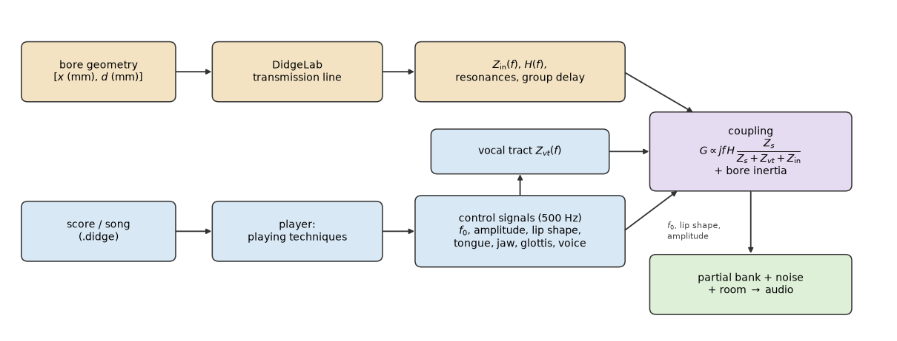

*Figure 0. From bore geometry and score to sound.*

---

## 1. The bore

### 1.1 Transmission-line model

A didgeridoo bore is described as a list of points $(x_i, d_i)$ (position and
diameter, in mm) — the DidgeLab format. Between two points the bore is a
truncated cone. DidgeLab computes, for every segment, a $2\times2$ transfer
matrix that maps the acoustic pressure $p$ and volume flow $U$ at its output to
its input (Mapes-Riordan, 1991), as implemented in Geipel's CADSD (Geipel, 2003):

```math
\begin{pmatrix}p_{\text{in}}\\U_{\text{in}}\end{pmatrix}
= \mathbf T_i(\omega)\begin{pmatrix}p_{\text{out}}\\U_{\text{out}}\end{pmatrix}.
```

With the segment length $L$, the slant length $l$, the distances $x_0, x_1$ of
the two ends from the cone apex, the propagation constant $\Gamma$ and the
characteristic impedance $Z_c$, the matrix of a cone is

```math
\mathbf T =
\begin{pmatrix}
\dfrac{x_1}{x_0}\Big(\cosh\Gamma l - \dfrac{\sinh\Gamma l}{\Gamma x_1}\Big) &
\dfrac{x_0}{x_1} Z_c \sinh \Gamma l \\[2ex]
\dfrac{1}{Z_c}\Big[\Big(\dfrac{x_1}{x_0}-\dfrac{1}{\Gamma^2x_0^2}\Big)\sinh\Gamma l
 + \dfrac{\Gamma l}{(\Gamma x_0)^2}\cosh\Gamma l\Big] &
\dfrac{x_0}{x_1}\Big(\cosh\Gamma l + \dfrac{\sinh\Gamma l}{\Gamma x_0}\Big)
\end{pmatrix},
```

and for a cylinder

```math
\mathbf T = \begin{pmatrix}\cosh\Gamma L & Z_c\sinh\Gamma L\\ \sinh\Gamma L / Z_c & \cosh\Gamma L\end{pmatrix}.
```

Visco-thermal losses at the wall enter through the ratio of the mean radius to
the thickness of the viscous boundary layer,
$`r_v = \sqrt{\rho\,\omega\,\bar A/(\pi\eta)}`$:

```math
\Gamma = \frac{\omega}{c}\left[\frac{1.045}{r_v} + j\left(1+\frac{1.045}{r_v}\right)\right],
\qquad
Z_c = \frac{\rho c}{A_0}\left[1+\frac{0.369}{r_v} - j\frac{0.369}{r_v}\right].
```

The whole bore is the product $\mathbf M = \prod_i \mathbf T_i =
\begin{pmatrix}A&B\\C&D\end{pmatrix}$, terminated at the bell by the radiation
impedance $Z_r$ (DidgeLab: $`Z_r = \tfrac12 Z_c\,[(\omega d/c)^2 + j\,0.6\,L\,\omega d/c]`$
of the last segment). Air properties are those of DidgeLab's default: moist air
at 28 °C ($c = 350.2$ m/s, $\rho = 1.156$ kg/m³).

### 1.2 What the synthesizer needs from the bore

DidgeLab returns the magnitude of the **input impedance**

```math
Z_{\text{in}} = \frac{p_0}{U_0} = \frac{A Z_r + B}{C Z_r + D}.
```

Its peaks are the playable notes: the drone and the toots. For a sound we also
need to know how much of the flow entering the mouthpiece arrives at the bell.
With $p_N = Z_r U_N$ the second row of the matrix equation gives
$`U_0 = (C Z_r + D)\,U_N`$, hence the **flow transfer function**

```math
H(\omega) = \frac{U_N}{U_0} = \frac{1}{C Z_r + D}.
```

`didgelab/synth/bore.py` evaluates exactly DidgeLab's formulas, vectorised over
frequency, on a 0.5 Hz grid up to 12 kHz, and keeps the complex values. A unit
test checks that $|Z_{\text{in}}|$ agrees with `didgelab.acoustical_simulation`
(relative error $< 10^{-9}$, measured $\approx 10^{-14}$). The resonances
(drone and toots) are taken directly from DidgeLab and refined with a 0.05 Hz
sweep.

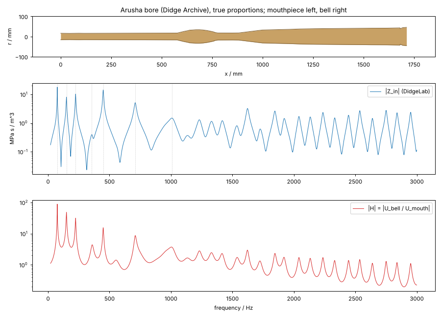

*Figure 1. Bore of "Arusha" from the Didge Archive, $|Z_{\text{in}}|$ from
DidgeLab and $|H|$. Both have their peaks at the resonances.*

---

## 2. The lips

### 2.1 Why the Didge2Wav excitation is too dull

Didge2Wav used a lip excitation model with smooth flow, taken from
Hindle & Posnett (2017), who attribute it to Fletcher (1996):

```math
u(t) = \frac{p_0}{R} - \frac{p_0^2/R^3}{\big(a_0 + a\sin 2\pi f_0 t\big)^2}.
```

Up to scale and offset this is $-(1+\alpha\sin\theta)^{-2}$ with $\alpha = a/a_0$.
The function is analytic in $\theta$; its poles lie at
$`\theta = -\tfrac{\pi}{2} \pm j\,\mathrm{arccosh}(1/\alpha)`$. The Fourier
coefficients therefore decay **exponentially**,
$`|U_n| \propto e^{-n\,\mathrm{arccosh}(1/\alpha)}`$: for $\alpha = 0.85$ that is
5 dB per harmonic, i.e. the 40th harmonic (3 kHz for a drone in D) is 200 dB
below the fundamental. Didge2Wav needed an additional exponent on $|Z|$ and a
vowel filter to compensate. The recordings of the Didge Archive instead show
harmonics up to 5 kHz that fall off with a power law.

### 2.2 Beating lips

The lips of a didgeridoo player *close* during part of every cycle. During the
open phase the flow through the lips follows a Rosenberg-type pulse
(Rosenberg, 1971). With the
open quotient $\text{OQ}$ (fraction of the period the lips are open) and the
skew $s$ (fraction of the open phase spent opening), $`T_p = s\,\text{OQ}`$,
$`T_n = (1-s)\,\text{OQ}`$, $\tau \in [0,1)$:

```math
u(\tau) =
\begin{cases}
\tfrac12\big(1-\cos(\pi\tau/T_p)\big) & 0 \le \tau < T_p\\
\cos\big(\tfrac{\pi}{2}(\tau - T_p)/T_n\big) & T_p \le \tau < T_p + T_n\\
0 & \text{otherwise.}
\end{cases}
```

The slope jumps at the instant of closure, so the coefficients decay as
$|S_n| \sim n^{-2}$ (−12 dB/octave). This agrees with stroboscopic
measurements of the lip opening of a didgeridoo player, whose harmonics fall
off as $`s_n \approx s_0/n^2`$ (Fletcher et al, 2006). The coefficients $S_n(\text{OQ}, s)$ are
tabulated and normalised to unit AC power, so that OQ and $s$ change only the
timbre (smaller OQ = brighter), not the loudness.

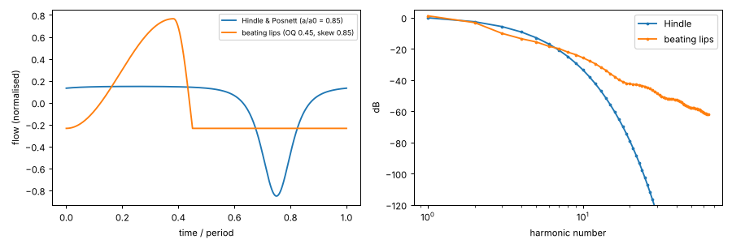

*Figure 2. One period and harmonic spectrum of the Fletcher (1996) / Hindle & Posnett (2017) source and of
the beating-lip source.*

### 2.3 The lips as a source with an internal impedance

The lips are a valve driven by the pressure difference between mouth and
mouthpiece. Linearising the valve around its operating point, the AC flow is

```math
U = U_s - \frac{\Delta p}{Z_s},
```

where $U_s$ is the flow the oscillating lips would deliver into a short circuit
(the source spectrum $S_n$ above) and $Z_s$ is the dynamic resistance of the
valve. This turns out to be the key for the coupling with the player's vocal
tract.

---

## 3. The vocal tract

### 3.1 Why it matters

The acoustic impedance of the vocal tract of didgeridoo players, measured while
playing, is comparable to that of the instrument (Tarnopolsky et al, 2005). The air flow through the lips is shared between the two
impedances in series: where the vocal tract has a strong resonance (impedance
maximum), little flow passes the lips and the radiated spectrum has a minimum;
the bands between these minima are heard as **formants** (Fletcher, 1983;
Tarnopolsky et al, 2005). Moving the tongue
moves the formants — this is the "tongue front / tongue back" or *wah*
technique.

### 3.2 Articulatory model

The tract from the lips to the glottis (16.5 cm) is a chain of $N=24$ lossy
cylinders (Kelly & Lochbaum, 1962). Its area function depends on four
articulatory parameters in
$[0, 1]$:

| parameter | meaning |
|---|---|
| tongue position $\tau$ | place of the tongue constriction, 1.5 cm (tip, alveolar) … 13 cm (pharynx) behind the lips |
| tongue height $h$ | 0 = low, 1 = full closure (stop consonant) |
| mouth $m$ | jaw opening: scales the oral tract by $2^{2.5(m-0.5)}$ |
| glottis $g$ | 0 = closed (phonation), 1 = wide open (breathing) |

```math
A(x) = A_{\text{scale}}\;2^{2.5(m-0.5)}\Big[A_0(x) - \big(A_0(x) - a_{\min}(h)\big)\,b(x)\,\min(1,\,1.6h+0.2)\Big],
```

with a neutral profile $A_0(x)$ (front cavity, palate, pharynx), a tongue bump
$`b(x) = \min\big(1, 1.3\,e^{-(x-x_c)^2/2w^2}\big)`$ centred at
$`x_c = 1.5\,\text{cm} + 11.5\,\text{cm}\cdot\tau`$ (its flat core makes a closure
complete), and $a_{\min}(h) = 10^{-7} + 0.5\cdot10^{-4}(1-h)^{1.5}$ m².

Each cylinder has the matrix

```math
\begin{pmatrix}\cosh\gamma\Delta & Z_k\sinh\gamma\Delta\\ \sinh\gamma\Delta/Z_k & \cosh\gamma\Delta\end{pmatrix},
```

$Z_k = \rho c / A_k$, with a propagation constant whose real part produces
formant bandwidths of about 60 Hz at 1 kHz (soft walls plus boundary layer):

```math
\gamma = \frac{\pi\big(B_0 + B_1\sqrt{f/1\,\text{kHz}}\big)}{c} + j\frac{\omega}{c},
\qquad B_0 = B_1 = 30\ \text{Hz}.
```

The glottis is a 1 cm orifice of area $`5\cdot10^{-6} + 1.5\cdot10^{-4}\,g^2`$ m²,
followed by the trachea (12 cm, 2.5 cm²) that ends in the lungs (reflection-free,
$Z_t = \rho c/A_{\text{tr}}$). Seen from the lips,

```math
Z_{vt} = \frac{a Z_t + b}{c Z_t + d}, \qquad
\begin{pmatrix}a&b\\c&d\end{pmatrix} = \prod_{k=1}^{N}\mathbf T_k\;\mathbf T_{\text{glottis}}\;\mathbf T_{\text{trachea}}.
```

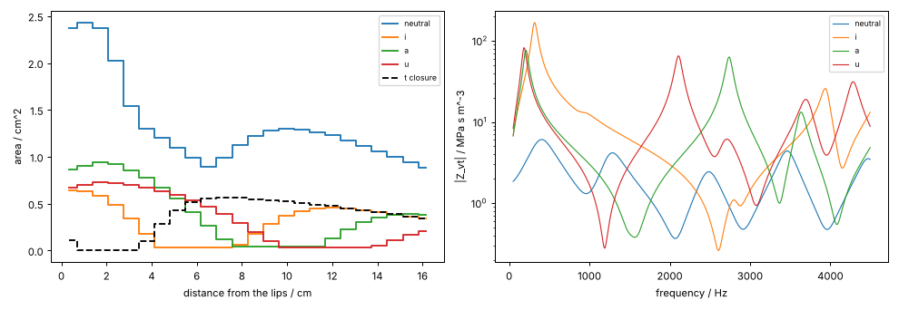

*Figure 3. Area functions (left) and impedance seen from the lips (right) of the
relaxed neutral mouth and of the articulated mouth shapes "ee" (tongue front),
"a" and "oo" (tongue back). Dashed: tongue closure of a "t".*

---

## 4. Coupling lips, vocal tract and bore

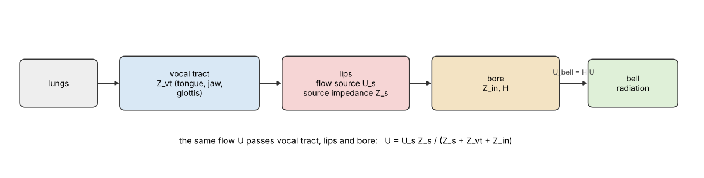

*Figure 3b. Lips, vocal tract and bore are acoustically in series.*

The same volume flow $U$ passes the vocal tract, the lips and the bore. The
mouth pressure is $p_{\text{mouth}} = -Z_{vt}U$ (AC part), the mouthpiece
pressure $p_0 = Z_{\text{in}}U$, so $\Delta p = -(Z_{vt}+Z_{\text{in}})U$ and the
valve equation of §2.3 gives

```math
U(\omega) = U_s(\omega)\,\frac{Z_s}{Z_s + Z_{vt}(\omega) + Z_{\text{in}}(\omega)}
```

This has the same form as the first-order solution of Fletcher et al (2006,
eq. 23) for a Bernoulli lip valve between vocal tract and didgeridoo, where
the role of $Z_s$ is played by $`(2p_0/\rho)^{1/2}/s_0`$ ($p_0$ mouth pressure,
$s_0$ mean lip opening area).

The flow at the bell is $`H\,U`$; the bell radiates as a small monopole,
$`p_{\text{rad}} = j\omega\rho\,U_{\text{bell}}/(4\pi r)`$. Together, the
complex amplitude of harmonic $n$ of the radiated sound is

```math
P_n = a\; S_n(\text{OQ}, s)\; G(n f_0),
\qquad
G(f) = j\frac{f}{f_{\text{ref}}}\; H(f)\;
\frac{Z_s}{Z_s + Z_{vt}(f) + Z_{\text{in}}(f)}\;\Big(\frac{f}{1\,\text{kHz}}\Big)^{\kappa/20\log_{10}2},
```

where the last factor ($\kappa = 1$ dB/octave) accounts for the on-axis
directivity of the bell and the microphone. Note what the formula does:

* If $Z_s \gg Z_{vt}+Z_{\text{in}}$ the lips are an ideal flow source and the
  sound is $`j\omega H\,U_s`$ — the bore resonances dominate, the player has no
  influence. If $Z_s$ is small, the series sum $Z_{vt}+Z_{\text{in}}$
  controls the flow.
* $|Z_{vt}| \gg |Z_s + Z_{\text{in}}|$ over most of the spectrum and small only
  in narrow regions produces a narrow bright formant on a dark background — the
  characteristic didgeridoo sound (figure 4).

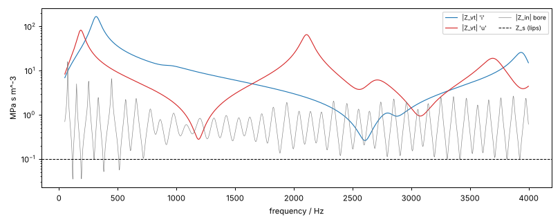

*Figure 4. Vocal-tract impedances for "ee" and "oo", bore input impedance (Matema)
and the lip source impedance $Z_s$.*

The played drone is the first resonance of DidgeLab; toots are played on the
higher resonances. The Didge Archive shows that toots sound about 45 cents
below the DidgeLab resonance (§7.2), which is used as the default.

---

## 5. Rendering

### 5.1 Control signals

A performance is described by control signals sampled at 500 Hz: lip frequency
$f_0(t)$, lip amplitude $a(t)$, open quotient, skew, the four vocal-tract
parameters, breath-noise and frication levels, vocalisation level and pitch,
and a nasal-noise envelope. The playing techniques (§6) generate these signals.

### 5.2 Partial bank

The lip tone is an additive bank of harmonics,

```math
y(t) = \sum_{n=1}^{N} \mathrm{Re}\Big\lbrace A_n(t)\,e^{\,jn\theta(t)}\Big\rbrace,
\qquad \theta(t) = 2\pi\!\int_0^t f_0(t')\,dt',
\qquad A_n(t) = a(t)\,S_n(t)\,G\big(nf_0(t); \mathbf v(t)\big),
```

with all harmonics up to 10 kHz. $A_n$ is computed per control frame and
linearly interpolated to the audio rate. Because the complex gain $G$ includes
the phase of the bore, vocal tract and lips, moving the tongue changes amplitudes
*and* phases of the partials, as in reality. The vocal-tract impedance is
computed once per distinct articulation on a 20 Hz grid and interpolated; the
powers $e^{jn\theta}$ are built by repeated multiplication. Rendering runs faster
than real time.

### 5.3 The bore needs time: envelope inertia

The partial amplitudes $A_n(t)$ above are *steady-state* values. A real bore
stores energy in its standing waves: near a resonance of bandwidth $B$ a partial
builds up and decays with the time constant $\tau = 1/(\pi B) = Q/(\pi f)$
— for a drone at 75 Hz with $Q \approx 30$ that is 0.13 s. This is why a tongue
stop of 20–30 ms only lowers the drone by a few dB in the recordings (§9), while
the steady-state model predicts a drop of more than 20 dB for an alveolar closure.
Each partial's complex amplitude is therefore passed through a one-pole filter
whose time constant is the **group delay of the bore**,

```math
\tau(f) = -\frac{d\arg H(\omega)}{d\omega}\Big|_{\omega=2\pi f}
\quad(\text{clipped to } 2\ldots300\ \text{ms}),
\qquad
A_n[k] \leftarrow e^{-\Delta t/\tau_n}A_n[k-1] + \big(1-e^{-\Delta t/\tau_n}\big)A_n[k].
```

For a resonance the group delay equals $1/(\pi B)$: for the Tamaki1 drone
(bandwidth 1.98 Hz, $Q = 38.9$) it is 161 ms, between resonances only 2–10 ms.
The low resonances are only 1–3 Hz wide, so below 1.5 kHz the group delay is
evaluated on a 0.02 Hz grid as $-\mathrm{Im}(d\ln H/d\omega)$. Partials on resonances therefore change slowly, partials between them
quickly — consonants appear as short vertical stripes in the upper spectrum
while the drone keeps sounding, exactly as in the recordings.

### 5.4 Vocalisation

Singing into the didgeridoo modulates the pressure that drives the lips. With
the voice $v = \mathrm{Re}\sum_k V_k e^{jk\phi}$ (pitch $f_v$, a
−12 dB/octave glottal spectrum) the lip flow becomes
$`u\,(1+\beta v) + v`$. Since
$`\mathrm{Re}\,X\cdot\mathrm{Re}\,Y = \tfrac12\mathrm{Re}\,XY + \tfrac12\mathrm{Re}\,X\bar Y`$,
this creates **sum and difference tones**

```math
\tfrac{\beta}{2} S_n V_k\, e^{j(n\theta + k\phi)}
\quad\text{and}\quad
\tfrac{\beta}{2} S_n \bar V_k\, e^{j(n\theta - k\phi)},
```

at the frequencies $n f_0 \pm k f_v$, which give vocalised didgeridoo its growl.
Each partial is filtered with $G(|nf_0\pm kf_v|)$ (conjugated if the
instantaneous frequency is negative).

### 5.5 Noise

Breath noise at the lips, $`\nu(t)\,b(t)\,\tfrac{1 + 0.8\cos\theta(t)}{1.8}`$
(pulsed with the lip cycle), and frication noise of consonants (band-pass
around the place of articulation) are filtered frame by frame with $|G|$ in the
STFT domain. The nasal inhalation of circular breathing does not pass the bore
and is added as band-pass noise (1.5–6 kHz). A short exponential-noise reverb
(RT60 = 0.45 s) imitates a small room.

---

## 6. Playing techniques

Each technique is a gesture on the control signals. Vowel targets are smoothed
with a 50 ms time constant (the mouth glides); consonants are applied on top.

| technique | score | model |
|---|---|---|
| drone, mouth shape | `doo`, `oo`, `ee`, `wa`, `uh` | target vocal tract; "ee" (tongue front) … "oo" (tongue back) move the formant from ≈2.5 kHz down to ≈1.2 kHz |
| stop consonants | `di ga`, `ti ka` | tongue closure ($h\to1$) at the alveolar ridge (t, d) or velum (k, g) for 15–45 ms ending on the beat; the closed tract chokes the flow, a small extra dip of the lip amplitude (t/k deeper than d/g); release burst; brightening after the release. Through the bore inertia the total level drops by only 1–8 dB |
| rolled r / trill | `rr` | tongue tip vibrating at ≈26 Hz: periodic near-closures, amplitude modulation |
| toot | `*too`, `**too` | lips on the 2nd/3rd bore resonance (−45 cents), louder and brighter |
| vocalisation | `~oo@C4` | voice modulates the lip flow: sum and difference tones; glottis adducted |
| glides | `wa`, `ya` | start from "oo"/"ee" and move to the vowel |
| fricatives | `h`, `ch`, `s` | near-closure, frication noise, reduced lip amplitude |
| accent, lip pulse | `!`, `p` | short amplitude boost and smaller open quotient |
| circular breathing | `^` | back of the tongue seals the mouth (tongue back, closed), cheeks push the stored air (accent), nasal inhalation noise, slight pitch drop |

A performance is humanised with timing jitter, slow pitch wander (±4 cents),
amplitude shimmer and a slow wander of tongue and jaw.

Audio examples (rendered by `scripts/synth/make_figures.py` to `outputs/synth-audio/`, Arusha bore unless noted):

| file | content |
|---|---|
| `arusha-drone.mp3` | plain drone |
| `arusha-tongue-front-back.mp3` | "ee"–"oo" alternation |
| `tongue-sweep-matema.mp3` | slow tongue sweeps on the Matema bore (figure 6) |
| `arusha-stops-diga.mp3` | *di ga*, *ti ka*, *da da ga* |
| `arusha-trill.mp3` | rolled r |
| `arusha-toots.mp3` | toots on the 2nd and 3rd resonance |
| `arusha-vocalisation.mp3` | singing C4 and G3 into the instrument |
| `arusha-circular-breathing.mp3` | rhythm with two circular breaths |
| `*-groove.mp3` | the same groove on Arusha, Malveira, Kizimkazi, Tamaki1, Matema and the Didge2Wav cone |
| `*-neutral-synth.mp3` | neutral drone of every archive instrument (figure 5) |
| `resynth-*.mp3` | copy synthesis of the archive recordings (§9) |

---

## 7. Calibration and realism: the Didge Archive

The Didge Archive contains, for nine didgeridoos, the measured bore together with
recordings: a neutral drone, hand slaps on the mouthpiece (open / closed hand)
and a song or a long performance. One index entry points to the wrong geometry:
"Tamaki2" refers to the Open Didgeridoo file, but `tamaki2.json` exists and its
simulated drone matches the recording (−10 instead of −45 cents), so
`tamaki2.json` is used.

### 7.1 Drone pitch

The simulated drone (first DidgeLab resonance) is compared with the median
pitch of each neutral recording:

| instrument | simulated / Hz | recorded / Hz | error / cents |
|---|---|---|---|
| Malveira | 93.9 | 94.0 | +2 |
| Arusha | 74.8 | 75.3 | +13 |
| Nazare | 74.9 | 74.5 | −10 |
| Kizimkazi | 74.7 | 74.5 | −6 |
| Open Didgeridoo | 74.1 | 74.8 | +15 |
| Open Didgeridoo Straight | 74.1 | 75.2 | +25 |
| Tamaki1 | 76.8 | 77.3 | +10 |
| Tamaki2 | 72.6 | 72.2 | −10 |
| Matema | 74.8 | 72.9 | −45 |

Mean absolute error 15 cents, mean error −1 cent: DidgeLab predicts the drone
within the precision with which a player holds it. The model therefore plays the
drone exactly on the impedance peak.

### 7.2 Toots

In the song recordings, stable pitches above the drone were clustered. A cluster
counts as a toot only if it is closer to a simulated resonance than to a
harmonic of the drone (a strong harmonic or formant could otherwise be mistaken
for a toot). Toots were found for three instruments (the Matema one is
ambiguous):

| instrument | recorded / Hz | DidgeLab resonance / Hz | error / cents |
|---|---|---|---|
| Tamaki1 | 212.9 | 218.0 | −41 |
| Tamaki2 | 196.0 | 201.8 | −50 |
| Matema* | 145.5 | 149.8 | −50 |

\*the Matema toot is also close to the 2nd harmonic of its (flat) drone.
Toots are played consistently **40–50 cents below** the resonance, while the
drone is not. A plausible reason is that the lips cannot follow the higher,
narrower resonance exactly (an outward-striking lip valve plays below the
resonance) and that the radiation model, which matters more for the higher
modes, shifts them. The synthesizer plays toots 45 cents below the resonance.

### 7.3 Hand slaps: the resonances themselves

Slapping the mouthpiece excites the bore. With the hand closing the mouthpiece
(closed–open tube) the spectral peaks should be the impedance **maxima**, with
the hand lifted away (open–open tube) the impedance **minima**. For the first
four maxima/minima of each instrument, the strongest spectral peak within
±150 cents was compared with the simulation:

| | n | median error | within 50 cents |
|---|---|---|---|
| hand closed ↔ $\max \lvert Z_{\text{in}}\rvert$ | 20 | 30 cents | 75 % |
| hand open ↔ $\min \lvert Z_{\text{in}}\rvert$ | 20 | 42 cents | 65 % |

The slaps are short (0.1–0.5 s) and noisy, so these numbers are an upper bound
of the model error; they nevertheless confirm the open/closed assignment —
e.g. for Arusha the open-hand peaks lie at 105.5, 181.6, 311, 584 Hz and the
impedance minima at 105.5, 183.5, 314, 584.5 Hz.

### 7.4 The timbre of the drone

**Harmonic fingerprint.** The relative levels of the first ten harmonics are
the "fingerprint" of a bore: whether a harmonic falls on a resonance or between
two resonances changes its level by 10–30 dB (Kizimkazi, whose resonances lie at
1, 3, 5, 7.3 times the drone, has strong odd harmonics). For each neutral
recording $i$ the measured pattern was compared with the model pattern of every
instrument $j$ at the recorded pitch, allowing a free offset and spectral tilt
(recording chain). If the model is realistic, recording $i$ should be closest to
model $i$:

| model | correct instrument | mean rank of the correct one | rms difference |
|---|---|---|---|
| this synthesizer | **6 / 9** (67 %) | 1.0 | 5.6 dB |
| Didge2Wav ($\lvert Z\rvert^{1.2}$ · Hindle) | 3 / 9 (33 %) | 2.1 | 10.3 dB |
| chance | 12.5 % | | |

(Open Didgeridoo and its straight version share one geometry and count as one
class.)

**Spectral envelope.** One-third-octave band levels (63 Hz–5 kHz) of the
harmonics of the neutral recordings were compared with the model (only a
common gain is fitted). The global parameters (open quotient, skew, $Z_s$,
neutral mouth shape, directivity tilt) were fitted with leave-one-instrument-out
cross-validation:

| model | rms band error |
|---|---|
| this synthesizer, leave-one-out | **5.1 dB** |
| this synthesizer, final defaults | 5.7 dB |
| generic $1/n$ harmonic spectrum | 6.1 dB |
| Didge2Wav | 26.5 dB |

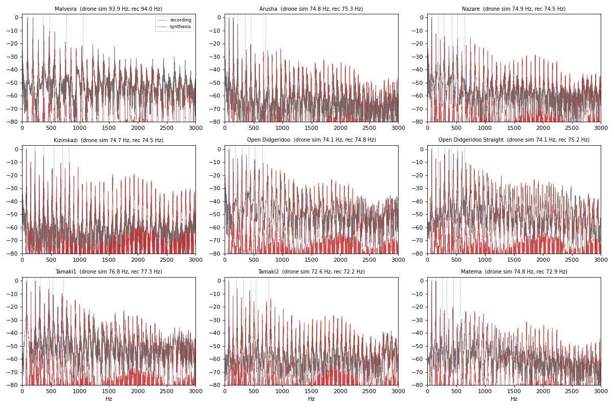

*Figure 5. Spectra of the neutral recordings (grey) and of the synthesized neutral
drones (red) for all instruments of the Didge Archive; dotted: DidgeLab
resonances.*

### 7.5 Calibrated parameters and what the data could not decide

| parameter | value | determined by |
|---|---|---|
| bore losses | DidgeLab unchanged | fingerprint and band levels did not improve with extra wall loss |
| open quotient OQ, skew | 0.45, 0.85 | band levels of the neutral drones (leave-one-out) |
| directivity tilt | +1 dB/octave | band levels |
| neutral mouth | tongue (0.3, 0.2), jaw 1.0, glottis 0.6 | band levels: relaxed, open mouth, open glottis |
| toot offset | −45 cents | §7.2 |
| tract area scale, $Z_s$ | 0.2, 0.1 MPa s m⁻³ | formant shape in the performances (below) |

Two things were *not* identifiable from the neutral drones: the source impedance
$Z_s$ and the overall width of the vocal tract. Band-level fits and frame-wise
inversions were flat (within 0.1 dB) over $Z_s = 0.1\ldots1$ MPa s m⁻³ and area
scales 0.2…1. They were fixed by the most striking feature of the performances:
when a player sweeps the tongue, the recording shows a **single narrow, bright
formant line** (prominence 10–17 dB) on a dark background (figure 6, top). A wide
tract or a large $Z_s$ produces only narrow dark notches on a bright background;
a narrow articulating tract (jaw nearly closed, tongue near the palate) with a
small lip source impedance reproduces the bright formant line with a prominence
of 12–18 dB (figure 6, bottom). The same model with a wide open jaw explains
the neutral drones, so "jaw opening" is one of the four articulatory parameters.

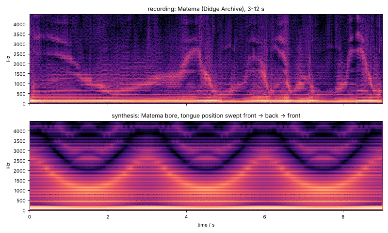

*Figure 6. Top: Matema recording with tongue sweeps. Bottom: synthesis on the
Matema bore with the tongue moving front → back → front.*

With these values the median band levels of a synthesized performance on the
Tamaki1 bore are within 0–5 dB of the Tamaki1 recording in all bands from
300 Hz to 4.5 kHz.


---

## 8. Finding the techniques in recordings

The second half of the task inverts the model: which techniques did the player
use? Three analyses are combined.

### 8.1 Which resonance do the lips play? (toots)

A generic pitch tracker confuses a drone whose fundamental is weak with a toot.
The lips of a didgeridoo player, however, lock to a resonance of the bore, so
the lip frequency is searched only in windows of ±90 cents around the DidgeLab
resonances $f_k$. With the log spectrum $L_t(f)$ of frame $t$, the score of a
candidate is the mean level of its first 12 harmonics relative to the frame
mean,

```math
s_t(f) = \frac{1}{12}\sum_{n=1}^{12} L_t(nf) - \overline{L_t},
\qquad
\hat s_{t,k} = \max_{|1200\log_2(f/f_k)|\le 90} s_t(f),
```

and the lips play on resonance
$`k^{\ast} = \min\lbrace k : \hat s_{t,k} \ge \max_j \hat s_{t,j} - 4\,\text{dB}\rbrace`$.
Taking the *lowest* resonance within 4 dB prevents octave errors: a toot is only
accepted if the drone's harmonics in between are clearly weaker. Unlike a
harmonic-contrast score this is not disturbed by vocalisation sidebands, which
fall between the harmonics.

### 8.2 Where is the tongue? (formant tracking)

A full inversion of the four vocal-tract parameters from the harmonic amplitudes
(grid search with Viterbi smoothing, implemented in `detect.VTInverter`) turned
out to be ill-posed: many configurations explain a frame almost equally well.
A much more robust feature is the dominant formant itself. For every frame the
spectral envelope $E_t(f)$ (maximum over ±40 Hz to bridge the harmonics, then
averaged over 250 Hz) is compared with the long-term envelope of the recording,
level and tilt are removed by an affine fit in $\log f$,

```math
R_t(f) = E_t(f) - \mathrm{median}_{t'} E_{t'}(f) - \alpha_t - \beta_t\log_2 f,
\qquad
F_t = \arg\max_{500\le f\le 4000} R_t(f),
```

and $F_t$ is accepted if its prominence $R_t(F_t) - \mathrm{median}_f R_t$
exceeds 4 dB. The physical model then translates the formant into a tongue
position: for the bore at hand, the model formant $F_{\text{model}}(\tau)$ is
computed along the tongue-position axis (it falls monotonically from front to
back), and the **tongue index** is $F_{\text{model}}^{-1}(F_t)$ normalised to
$[0,1]$ (0 = front, 1 = back), extrapolated in $\log f$ beyond the model range.

### 8.3 Learning the articulations from synthetic performances

Consonants, trills, vocalisation and circular breathing are detected by a
classifier that never sees a real recording during training:

1. **Data.** Random but idiomatic scores (cells such as `di ga`, `ti ka`, `rr`,
   `*too`, `~oo@E3`, pauses and detached notes, `^` every 2–5 s) are played by
   random players
   (open quotient, source impedance, closure depth and duration, trill rate,
   base vowel, breath noise, pitch offset) on **random parametric bores**
   (length 1.15–1.8 m, mouthpiece 28–34 mm, bell 55–100 mm, random bulges),
   rendered with random room, microphone tilt (±3 dB/octave), background noise
   (SNR 30–55 dB) and gain. Because the controls are known, every 10 ms frame
   has exact labels.
2. **Features** per frame: level and its derivatives and deviation from a running
   median, lip mode and pitch deviation from the resonance, inharmonic energy,
   non-harmonic high-band noise, amplitude modulation depth and rate (15–45 Hz),
   band energies (9 bands) and their derivatives, formant, its prominence and the
   tongue index, the inverted vocal tract; stacked with ±100 ms context and local
   mean/standard deviation.
3. **Model.** One gradient-boosted tree ensemble per technique (stop front, stop
   back, trill, voice, circular breath, fricative). A stop is reported for every
   run of $p_{\text{front}}+p_{\text{back}} > 0.5$ (runs longer than 120 ms are
   split at maxima at least 100 ms apart), the place of articulation by the
   larger of the two probabilities; the other techniques as runs of $p > 0.5$. Events are
   only reported where the instrument sounds (lip mode found, level within
   35 dB of the maximum).
4. **Evaluation on unseen instruments.** The detector is trained on random
   bores only and tested on synthetic performances on the **eight Didge Archive
   geometries**.

Results on 32 synthetic performances (20 s each) on the eight archive geometries,
detector trained on 80 performances on random bores:

| technique | precision | recall | F1 | events |
|---|---|---|---|---|
| stop consonants (±60 ms) | 0.97 | 0.97 | 0.97 | 844 |
| place of articulation (t/d vs. k/g) of detected stops | | | accuracy 0.987 | 823 |
| rolled-r trill | 0.97 | 1.00 | 0.98 | 64 |
| vocalisation | 0.92 | 0.90 | 0.91 | 72 |
| circular breathing | 1.00 | 0.99 | 0.99 | 139 |
| fricatives / aspiration | 0.88 | 0.82 | 0.85 | 77 |
| toots (lip tracker, no learning) | 0.99 | 1.00 | 0.99 | 67 |

(Detector retrained in DidgeLab, `scripts/synth/train_detector.py`; the stored
result is [results/synth/detector_eval.json](results/synth/detector_eval.json).)

These numbers measure how well the techniques *as modelled* can be recognised
on unseen instruments and recording conditions. They are an upper bound for real
recordings, where the techniques are executed differently from the model.

**A lesson from the first version.** The first detector was trained with stops
that interrupted the lip amplitude by 5–16 dB. On the archive recordings it found
almost no stops. A close look at the rhythmic part of Tamaki1 (figure 7) showed
why: real tongue articulations change the *total* level by only 2–5 dB for
20–30 ms; the drone keeps sounding and mainly the upper partials dip. This led
to the envelope inertia of §5.3 — a missing piece of physics that the
analysis-by-synthesis loop revealed — and to shallower stops in the training
data. Two further checks were added after inspecting real recordings: a
vocalisation must show sum and difference tones between the harmonics (the
strongest non-harmonic peak within 20 dB of the strongest partial; synthetic
vocalisation gives −18 … −1 dB, a plain drone −44 … −61 dB), and a trill must
show a 15–45 Hz amplitude modulation of at least 1.5 dB.

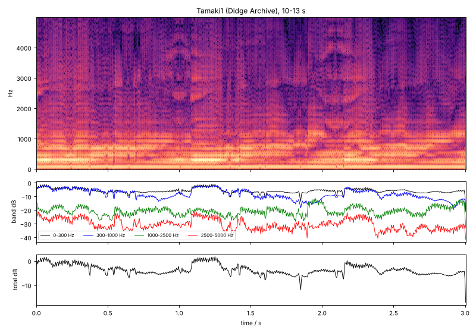

*Figure 7. Three seconds of the rhythmic part of Tamaki1: spectrogram, band
levels and total level. Articulations are short dips of 2–5 dB in the total
level and of 5–10 dB in the upper bands.*


---

## 9. What the players do in the Didge Archive recordings

`scripts/synth/analyze_recordings.py` transcribes all songs and long recordings of the
archive. The full transcriptions are in [`doc/results/synth/transcriptions/`](results/synth/transcriptions/), plots in
`doc/figures/transcription-*.png`, and copy-synthesised excerpts (f0, level and
mouth shape taken from the recording, §8.2) in `outputs/synth-audio/resynth-*.wav`.

| recording | dur. / s | drone / Hz (DidgeLab) | toots | formant median / p90 / Hz | tongue front / back | tongue moves / s | vocalisation / s | stops / s | circ. breaths |
|---|---|---|---|---|---|---|---|---|---|
| malveira-short-song | 24.7 | 93.4 (93.9) | – | 996 / 2681 | 0.25 / 0.68 | 1.38 | 0.5 | 1.34 | 1 |
| arusha-short-song | 22.3 | 75.5 (74.8) | – | 1951 / 3550 | 0.53 / 0.31 | 1.88 | 2.1 | 0.27 | 0 |
| nazare-short-song | 19.4 | 74.7 (74.9) | – | 1751 / 3279 | 0.47 / 0.40 | 1.18 | 1.8 | 0.88 | 1 |
| kizimkazi-short-song | 26.4 | 76.1 (74.7) | – | 1666 / 3927 | 0.41 / 0.28 | 1.21 | 3.3 | 0.42 | 3 |
| opendidge-short-song | 19.8 | 74.7 (74.1) | – | 2267 / 3745 | 0.68 / 0.24 | 1.77 | 0.7 | 0.46 | 0 |
| open-didge-drags | 9.0 | 73.5 (74.1) | 1 | 1593 / 2714 | 0.38 / 0.48 | 1.00 | 0.2 | 0.44 | 3 |
| opendidge-2-straight-long | 37.4 | 75.0 (74.1) | – | 1347 / 3688 | 0.41 / 0.52 | 2.03 | **30.6** | 0.13 | 0 |
| tamaki1-long | 37.4 | 76.6 (76.8) | 3 (1.1 s) | 2291 / 3179 | 0.57 / 0.41 | 1.87 | 2.6 | 0.37 | 1 |
| tamaki-2-long | 37.4 | 72.2 (72.6) | 1 (0.8 s) | 2083 / 3350 | 0.52 / 0.45 | 2.35 | 0 | 0.35 | 0 |
| matema-long | 32.7 | 73.5 (74.8) | 5 (1.1 s) | 1248 / 3281 | 0.40 / 0.54 | 2.08 | 0.9 | 0.52 | 0 |

*"tongue moves": front ↔ back excursions of the tongue index per second.*

What can be said with confidence, because it is supported by independent
physical evidence:

* **Drone.** All recordings are played on the first DidgeLab resonance
  (median deviation 14 cents, at most 32 cents).
* **Toots** appear in Tamaki1 (a 1.5 s toot passage at 26–27.5 s, figure 8),
  Tamaki2 and Matema, always on the 2nd resonance and 40–50 cents below it
  (§7.2). The other songs are pure drone songs.
* **Tongue front/back is the dominant technique.** In every recording the
  formant moves between ≈1 kHz (tongue back) and ≈3 kHz (tongue front),
  1–2.4 times per second. The players differ: Malveira's song stays mostly at
  the back (68 % of the time), the Open Didgeridoo song mostly at the front
  (68 %); Matema shows long, slow sweeps (figure 6), Tamaki1 and Tamaki2
  fast rhythmic changes.
* **Vocalisation** is used throughout `opendidge-2-straight-long` (31 of 37 s).
  The spectrum contains strong partials between the harmonics, e.g. at 274 Hz
  (−2 dB) and 398 Hz (−3 dB) with a drone at 74 Hz; they fit the sum and
  difference tones $n\cdot 74 \pm 199$ Hz of a voice at ≈199 Hz (≈G3) and its
  octave. In all other recordings the strongest non-harmonic peaks are
  20–35 dB weaker: vocalisation is at most occasional. (The absolute voice
  pitch cannot be determined from the sidebands alone, since
  $n f_0 \pm f_v$ is invariant under $f_v \to f_v + m f_0$; here the direct
  voice partials decide.)
* **No rolled-r trills.** The detector initially reported 18 trills in Matema,
  but none of them shows the periodic 20–40 Hz modulation of a trill
  (median 0.44 dB, the same as elsewhere); after the plausibility check no
  trill remains in the archive.
* **Detached notes.** The end of Tamaki1 (28–37 s) consists of seven short,
  decaying notes; `open-didge-drags` of seven separate notes that swell and
  decay with an upward glide of the formant (the tongue moving forward within
  each note).

What remains uncertain: the **stop consonants** (0.1–1.3 per second detected)
and **circular breathing** (0–3 events). The rhythmic articulation of these
players is carried mainly by fast formant changes; tongue stops, where they
occur, are subtler than in the model. Without listening tests or annotations
these detections should be read as hypotheses.

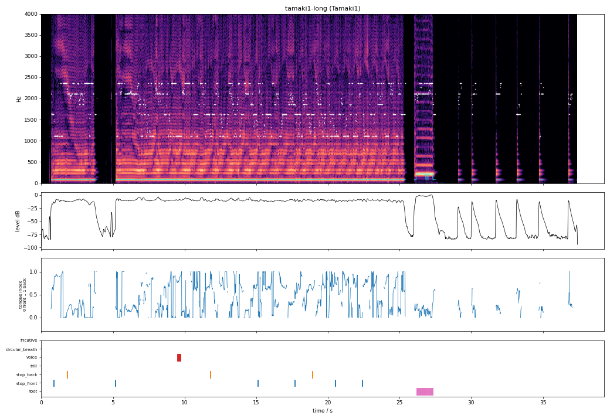

*Figure 8. Transcription of `tamaki1-long`: spectrogram with lip frequency
(cyan) and formant (white), level, tongue index and detected events.*

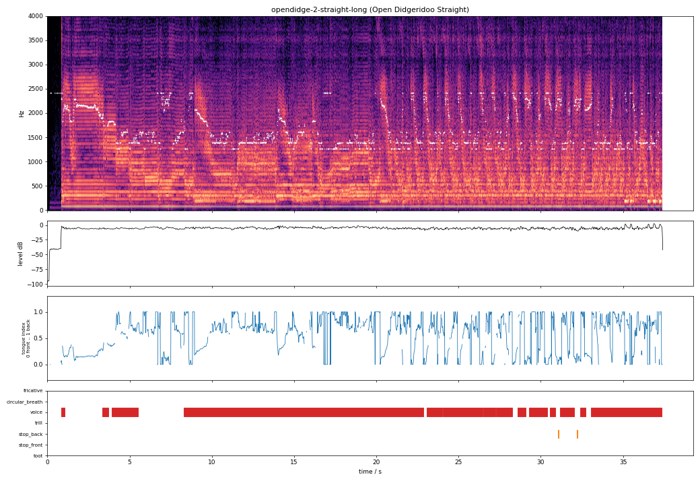

*Figure 9. `opendidge-2-straight-long`: continuous vocalisation (sum and
difference tones fill the spectrum between the harmonics).*


---

## 10. Limitations

* **The lip oscillation is prescribed, not self-sustained.** The lips play
  exactly on a resonance (drone) or 45 cents below it (toot). A physical
  lip-valve model that oscillates by itself would predict the playing
  frequency, how easily a toot speaks and the transients, but needs a
  time-domain simulation of the bore (reflection function) instead of the
  frequency-domain coupling used here.
* **Linearised coupling.** The series formula of §4 linearises the valve; the
  harmonics are generated by the prescribed pulse shape, not by the nonlinear
  interaction with the bore.
* **Formant range.** The articulated mouth shapes move the formant between
  ≈1.1 and ≈2.6 kHz; the recordings show formants from 0.6 to 3.4 kHz. The
  tongue index extrapolates outside this range, but the synthesizer cannot yet
  produce the lowest and highest formants with the same prominence.
* **Variability.** In synthesized performances the band levels vary more than
  in the recordings between 1 and 1.5 kHz and less between 2.2 and 4.5 kHz.
* **Identifiability.** $Z_s$ and the width of the tract are fixed by the
  appearance of the formant line, not by a fit; the full four-parameter
  vocal-tract inversion is ill-posed.
* **Small archive.** Nine instruments (eight geometries) and one player. The
  hand-slap and toot validations use short or few events.
* **Synthetic-to-real gap of the detector.** The detector is trained on
  synthetic performances only. Its accuracy on real recordings can only be
  checked qualitatively (§9), there are no human annotations of the archive
  recordings yet. Annotating a few minutes would allow a real evaluation and
  fine-tuning.
* **Bent bores.** Saxodidges (Arusha, Open Didgeridoo) are simulated as straight
  bores, like DidgeLab's TLM does; DidgeLab's 3-D FEM could add the bend.


---

## 11. Songs: writing grooves and loops

Grooves are written as text files (`songs/*.didge`, full description in
[song-format.md](song_format.md)). A song has a header and two lanes in bars:
the **rhythm** lane holds syllables, the optional **tongue** lane moves the
tongue independently of the syllables.

```
title:      Drone, tongue back to front
instrument: Arusha
tempo:      80

[rhythm]
| uh _ _ _ | _ _ _ _ | _ _ _ _ | _ _ _ _ |

[tongue]
| oo ~ ~ ~ | ~ ~ ~ ~ | ~ ~ ~ ~ | ~ ~ ~ ee |
```

* Every bar is divided equally among its tokens; ``:1/8`` sets a length
  explicitly. Hyphens split a token in equal parts, the syllables of a part
  share it: ``dong-tiki`` is an eighth *dong* and two sixteenths *ti ki*.
* A syllable is consonant + vowel + ending: *dong* = d + o + ng (the tongue
  moves to the velum at the end), *ti* = t + i (tongue front), *ri* = a single
  tongue flap. Every syllable sets the mouth shape of its vowel.
* In the tongue lane a value holds the tongue during its slot, `~` glides
  linearly to the next value, `.` holds (the next value then follows quickly),
  `auto` returns control to the syllables. Values are vowels (`ee` … `oo`),
  `front`/`mid`/`back` or numbers from 0 (front) to 1 (back); they are
  mapped onto the tongue axis of the vocal-tract model (§3.2).

Rendering (one shot, or a seamless loop: the loop is cut from a longer
performance and its end is crossfaded into its beginning):

```bash
didgelab-synth play src/didgelab/synth/songs/dong-ti.didge                      # one shot -> dong-ti.wav
didgelab-synth play src/didgelab/synth/songs/dong-ti.didge --tempo 120 --loop 4 # 4 bars, loopable
```

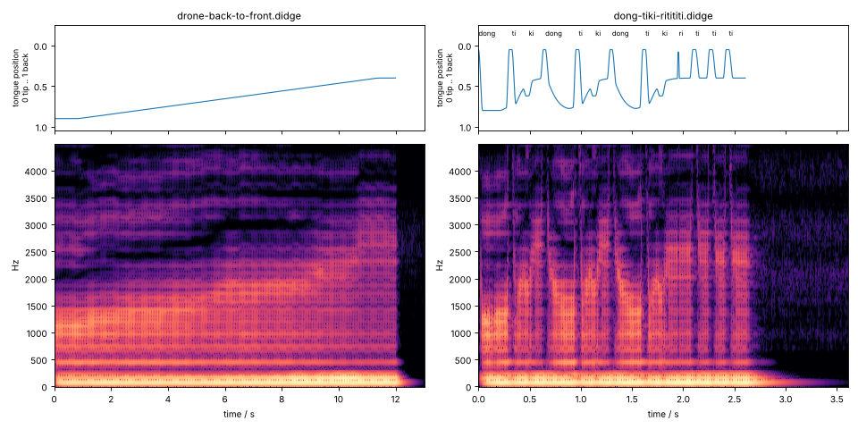

*Figure 10. Two songs: tongue position (top) and spectrogram (bottom). Left: a
four-bar drone whose tongue glides from back to front; the formant rises from
≈1.1 to ≈2.2 kHz. Right: "dong-tiki dong-tiki dong tiki ritititi"; every
consonant is a short closure, "dong" ends with the tongue moving back.*

## 12. Using it

```python
from didgelab.synth import synthesize
y, fs = synthesize([[0, 32], [1500, 72]], "tempo = 100\ndoo:2 di:.5 ga:.5 *too rr:2 ~oo:2@C4")
```

```bash
didgelab-synth synth geometry.json -s "doo:2 di:.5 ga:.5 ^ ti:.5 ka:.5" -o out.wav
didgelab-synth analyze recording.wav --geometry Arusha --plot transcription.png
```

## References

* Fletcher, N. H. (1983): *Acoustics of the Australian didjeridu*.
  Australian Aboriginal Studies 1, 28–37.
* Fletcher, N. H. (1996): *The didjeridu (didgeridoo)*. Acoustics Australia
  24, 11–16.
* Fletcher, N. H., Hollenberg, L. C. L., Smith, J., Tarnopolsky, A. Z., Wolfe, J.
  (2006): *Vocal tract resonances and the sound of the Australian didjeridu
  (yidaki) II. Theory*. JASA 119(2), 1205–1213.
  [PDF](https://www.phys.unsw.edu.au/~jw/reprints/Fletcheretal.pdf)
* Geipel, F. (2003): *CADSD – Computer Aided Didgeridoo Sound Design*.
  [didgeridoo-physik.de/cadsd/cadsd-method](https://www.didgeridoo-physik.de/cadsd/cadsd-method/)
* Hindle, A., Posnett, D. (2017): *Performance with an electronically excited
  didgeridoo*. Proc. NIME'17, Copenhagen.
  [PDF](https://softwareprocess.es/pubs/hindle2017NIME-didgeridoo.pdf)
* Kelly, J. L., Lochbaum, C. C. (1962): *Speech synthesis*. Proc. 4th ICA.
* Mapes-Riordan, D. (1991): *Horn modeling with conical and cylindrical
  transmission line elements*. AES Convention 91.
* Rosenberg, A. E. (1971): *Effect of glottal pulse shape on the quality of
  natural vowels*. JASA 49, 583–590.
* Tarnopolsky, A. Z., Fletcher, N. H., Hollenberg, L. C. L., Lange, B. D.,
  Smith, J., Wolfe, J. (2005): *The vocal tract and the sound of a didgeridoo*.
  Nature 436, 39.
* DidgeLab, Didge Archive, Didge2Wav: [didgitaldoo.github.io](https://didgitaldoo.github.io).
